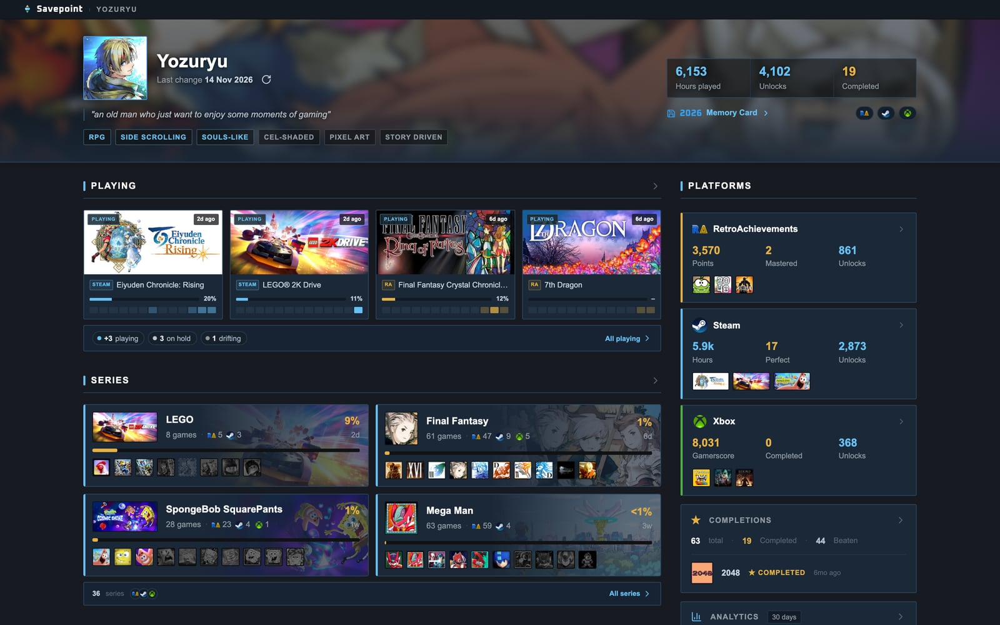
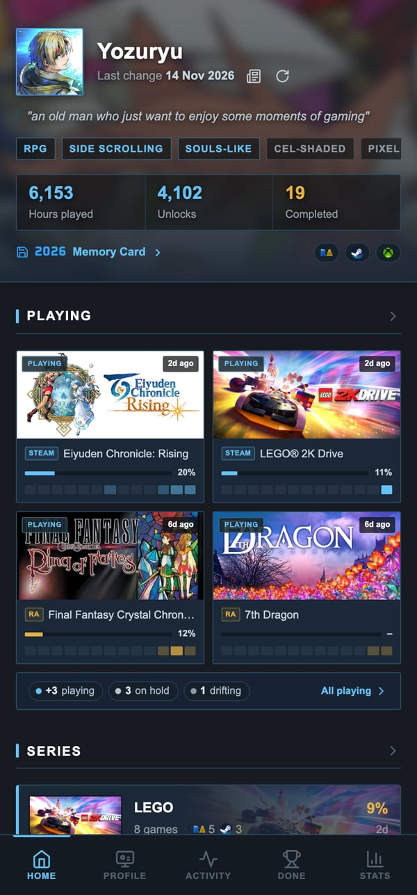
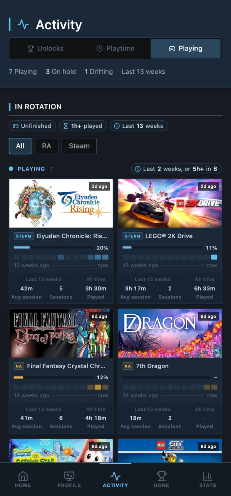
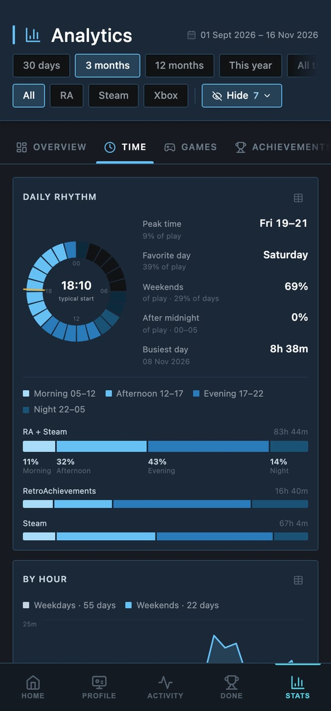
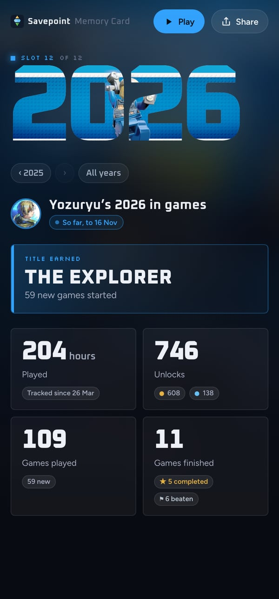
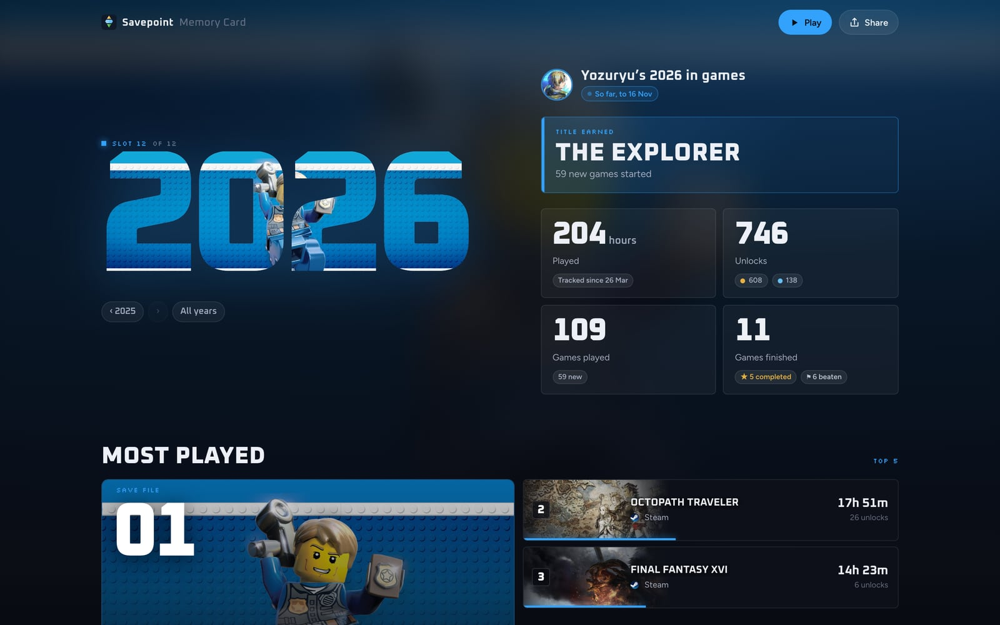
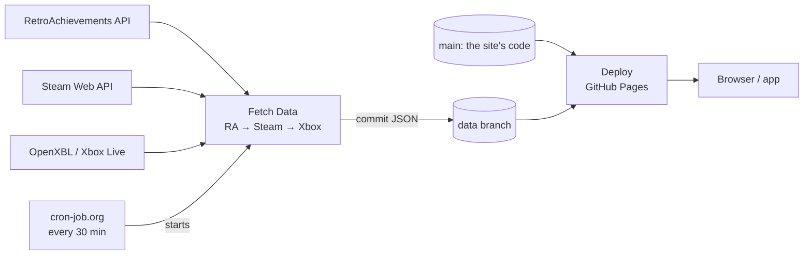

# Savepoint · Yozuryu

My RetroAchievements, Steam and Xbox progress on one site: profiles, what I'm playing, every game I've finished, a year of activity, and a page for each year in games.

**Live site → [yozuryu.github.io/my-savepoint](https://yozuryu.github.io/my-savepoint/)**

[](https://github.com/yozuryu/my-savepoint/actions/workflows/fetch-data.yml)
[](https://github.com/yozuryu/my-savepoint/actions/workflows/deploy.yml)



<p align="center">
  
  
  
  
</p>

## Made with Savepoint

This site is built with [Savepoint](https://github.com/yozuryu/savepoint), a free template: <https://github.com/yozuryu/savepoint>. It is where the template comes from, so new features land here first.

**Want your own?** Start from the template, not from this repository: it has the setup guide, runs on any GitHub account and address, and keeps itself up to date. Docs and a live demo are at <https://yozuryu.github.io/savepoint-site/>.

## What's on it

- **Hub**: the games in rotation, series across platforms, three numbers per platform, recent activity, and totals across all three.
- **Profiles** for RetroAchievements, Steam and Xbox: overview, progress, activity, series, and every game's achievements with rarity and unlock dates.
- **Playing**: games I'm actually playing, on hold or drifting away from, by play time over the last 13 weeks.
- **Activity**: a year of unlocks and play sessions on one timeline and heatmap.
- **Completions**: every mastered, perfect, completed and beaten game, by year and month.
- **Series**: series that span platforms, with sub-series and progress.
- **Analytics**: hours, unlocks, time of day, rarity and trends.
- **Memory Card**: a public page for each year, made to share. A title for the year, the top five, finished games, rarest unlocks, and a story that plays the year back. Each year takes its colour from its top game's art.
- **Installable**: built for a phone first, works as an app, updates itself.

Gold means completed, silver beaten, blue in progress, everywhere.



## How it works

No backend and no build step. One GitHub Actions workflow fetches the data, commits it to a `data` branch, and a second one publishes the site from `main` plus that branch.



| | |
|---|---|
| **Fetch** | `.github/workflows/fetch-data.yml`: all three pipelines in one run, every 30 minutes, with a fuller refresh at midnight UTC. A run with no new activity commits nothing |
| **Data** | JSON on the `data` branch, squashed daily so it never holds more than a day of history |
| **Deploy** | `.github/workflows/deploy.yml`: on every push to `main` and after every data run that changed something. Builds the series file and the Memory Card pages and pictures |
| **Site** | React, Tailwind and Lucide from CDNs, JSX compiled in the browser. No bundler, no install for the site |

Xbox sync is paused for now (`XBOX_ENABLED` in the fetch workflow); a manual run still syncs it.

## Running it locally

Needs Node.js 20.

```bash
npm install
npm run data:pull                  # the data branch into data/, plus the series file and Memory Card pages
python3 -m http.server 8765        # then open http://localhost:8765/
```

The pipelines can be run by hand for testing (`npm run ra-fetch`, `steam-fetch`, `xbox-fetch`, each with `:debug` for a dry run). They need a `.env` with `RA_USERNAME`, `RA_API_KEY`, `STEAM_USER_ID`, `STEAM_API_KEY` and `XBOX_API_KEY`. Publishing data only happens from GitHub Actions.

### Admin panel

```bash
npm run admin                      # http://localhost:3131
```

Local only, never published: site config, series, art picks, the lists of games to leave out of the numbers, win conditions, data runs and their schedule, and a diff of what changed before committing it.

## Where things are

```
index.html                 the hub
profile/ra|steam|xbox/     platform profiles
activity/ completions/     timeline, finished games
series/ analytics/         series across platforms, statistics
memory-card/page.html      the year pages are built from this one file
changelog/                 changelog viewer (reads changelog.md)
admin/                     the local admin panel
assets/                    shared scripts, styles and icons
data/                      hand-kept files; pipeline output lives on the data branch
scripts/                   pipelines, build scripts, the admin server
```

## Notes

- What changed and when: [`changelog.md`](changelog.md), also on the site's Changelog page.
- Planned work: [`backlog/`](backlog/README.md).
- Not affiliated with RetroAchievements, Valve, Microsoft or OpenXBL. Game names, icons and art belong to their owners.
